<div align="center">

# StockHop

### Find it nearby. Buy with confidence.

A city-aware online store for a retail chain moving online across India.<br>
Stock is local to your city and live to the second, search understands what you mean, and **the last unit can never be sold twice**.

**[Open the live store →](https://lucky-infinite-humpback.eur-1.aiven.app)**

Built on Aiven for PostgreSQL · Apache Kafka · OpenSearch · Valkey · ClickHouse · App Runtime

Team **Rangers** · Dr Ambedkar Institute of Technology · Build Bengaluru 2.0 (HackBriven × Newton School × Google) · 21–22 Nov 2026

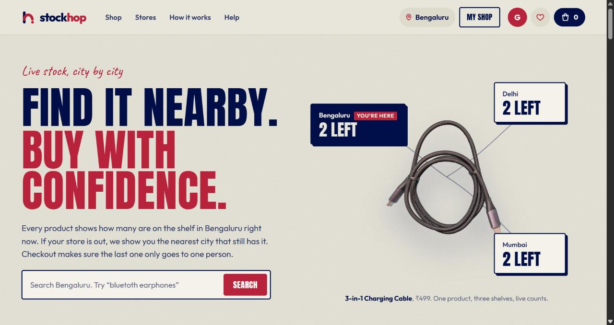

</div>

---

## Why StockHop

Big marketplaces say "in stock" when they mean "in a warehouse somewhere". They sell the last unit twice and apologise by email, and they dead-end you with "currently unavailable". StockHop is built the other way round:

| | |
|---|---|
| **Stock per city, live** | Every card shows how many are on the shelf in *your* city, re-checked every few seconds. |
| **The last one goes to one person** | Checkout takes stock under a row lock in PostgreSQL. A 50-shopper race for 5 units ends with exactly 5 orders, every time. |
| **Never a dead end** | Sold out here? You're shown a partner shop in your city, our store in another city, something similar on the shelf, or a ping when it's back. |
| **Search like you talk** | "keep my tea hot on the commute under 800" finds a vacuum flask. Typos, synonyms and plain sentences all work. |
| **Local shops sell through us** | Partner retailers get a storefront, a dashboard and live shoppers, so they sell instead of losing the sale. |

## A tour

<table>
<tr>
<td width="50%" valign="top">

**Suggestions as you type**<br>
<sub>Completions, products on the shelf with live counts, shops and categories, from one OpenSearch request. Arrow keys and Enter work, and an empty box shows trending searches.</sub>

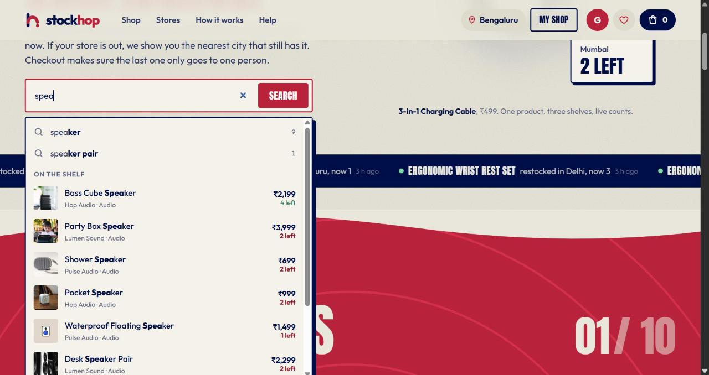

</td>
<td width="50%" valign="top">

**Typo-tolerant results, and who sells it**<br>
<sub>"hedphones" finds headphones. Each card shows its live count, who sells it, and which local shops also have it, from what price.</sub>

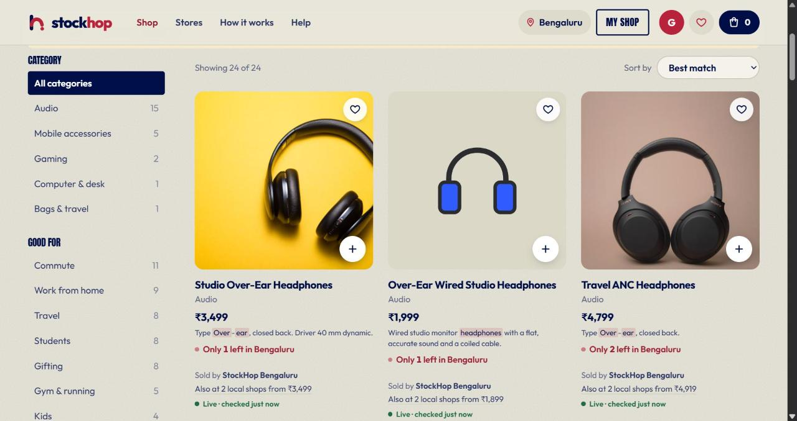

</td>
</tr>
<tr>
<td valign="top">

**Product page**<br>
<sub>Price, live shelf count and partner offers next to ours. "3 bought in Bengaluru this week" counts real orders only.</sub>

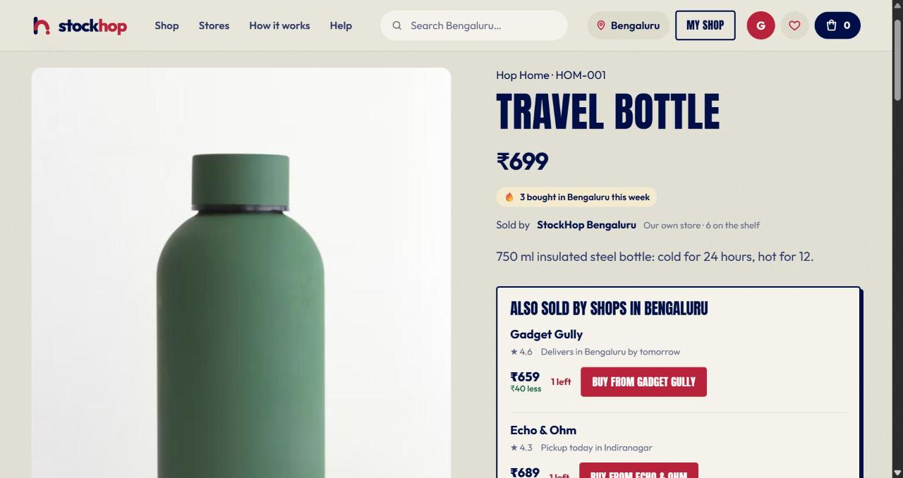

</td>
<td valign="top">

**Frequently bought together**<br>
<sub>Co-purchases from ClickHouse, kept to what's on the shelf in your city and topped up with items for the same uses. Tick the ones you want, then add them all in one go.</sub>

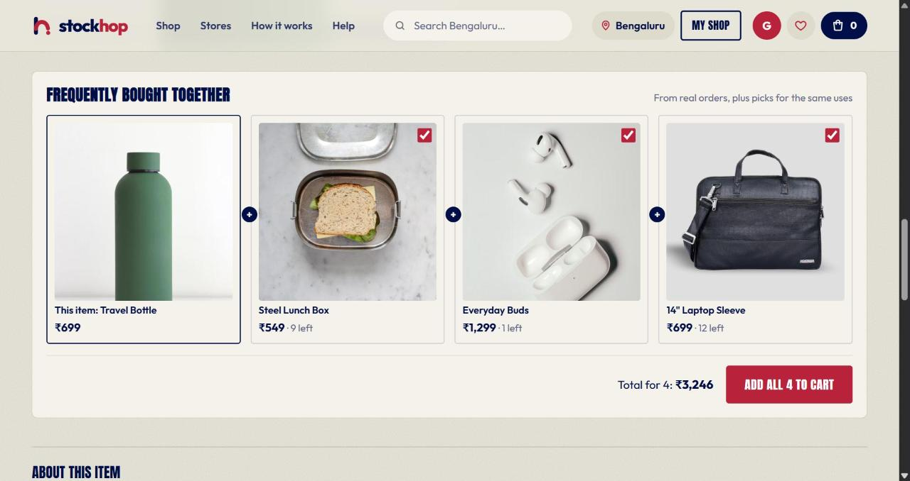

</td>
</tr>
</table>

### Two shoppers, one last unit

What happens when two people want the last pair of headphones in Bengaluru at the same time. These are two real browsers on the live site, captured seconds apart.

**1. Both open the product page and see the last one.**

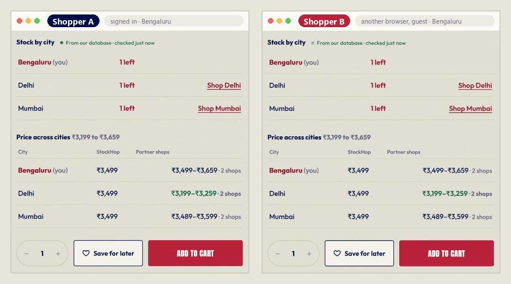

> **OpenSearch** got both shoppers here: search, suggestions and the live counts on result cards come from its index, which Kafka keeps in step with the database.
>
> **PostgreSQL** is the source of truth for stock. "Stock by city" and the price table are read from it directly, and each open product page re-reads it every 3 seconds.

**2. Shopper A taps Add to cart first. Shopper B is told within seconds, without reloading.**

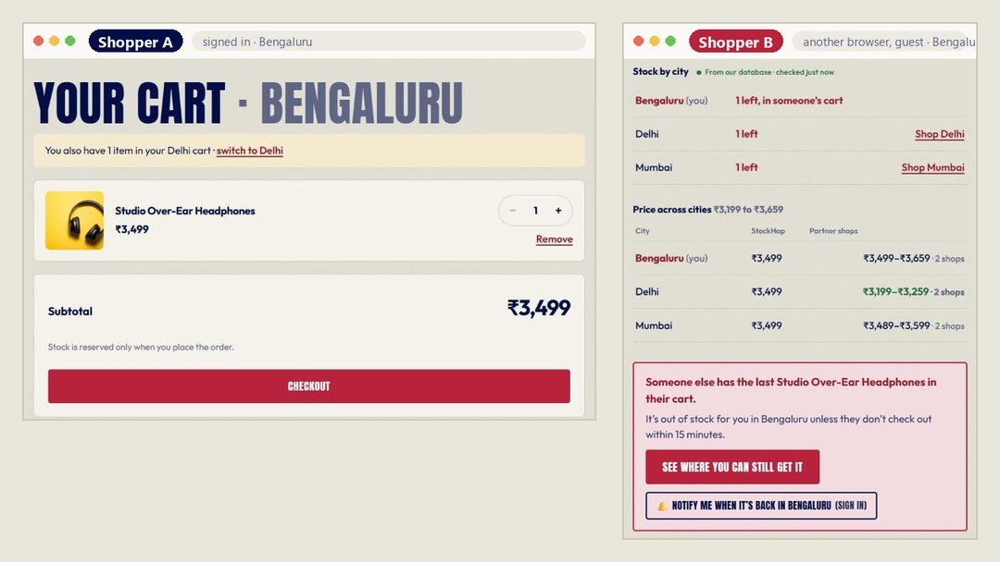

> **PostgreSQL** decides who wins. Adding to a cart locks the stock row (`SELECT … FOR UPDATE`) and counts what other carts already hold, so two taps on the last unit can't both succeed. The winner holds it for 15 minutes. If they don't check out, it goes back on the shelf by itself.
>
> Shopper B's next 3-second refresh sees *shelf 1, in other carts 1, available to you 0*. The button becomes a warning, and the count reads "1 left, in someone's cart".
>
> **Valkey** gets shopper A's "adding to cart" heartbeat. Shops that sell this item see it in their *Live now* panel (below) within 2 seconds.

**3. Shopper B is shown where they can still get it.**

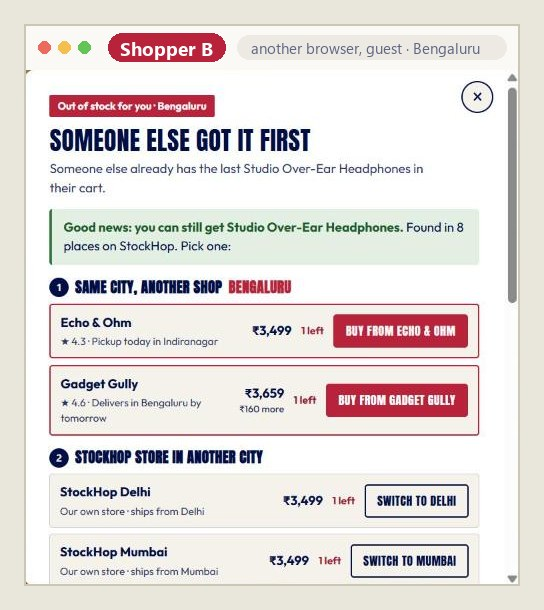

> **PostgreSQL** lists every place that still has it, with live counts:
>
> 1. partner shops in the same city first, with the price difference;
> 2. then StockHop stores in other cities;
> 3. then partner shops elsewhere.
>
> If shopper B buys from Echo & Ohm, that order goes through the same hold → pay → confirm flow. The order is written to an outbox table in the same transaction and published to **Kafka**. It lands in **ClickHouse**, where it shows up as a sale on Echo & Ohm's dashboard.

<table>
<tr>
<td width="50%" valign="top">

**Partner shop storefronts**<br>
<sub>Every partner shop has its own page: everything it sells, live stock, categories, and search inside the shop that tolerates typos.</sub>

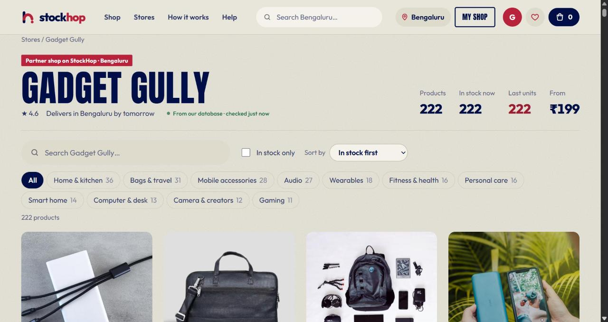

</td>
<td valign="top">

**The retailer sees shoppers live**<br>
<sub>A shop's dashboard shows who is on its items' pages, hovering over them or adding them to a cart, within 2 seconds (Valkey). Sales and regular customers come from ClickHouse.</sub>

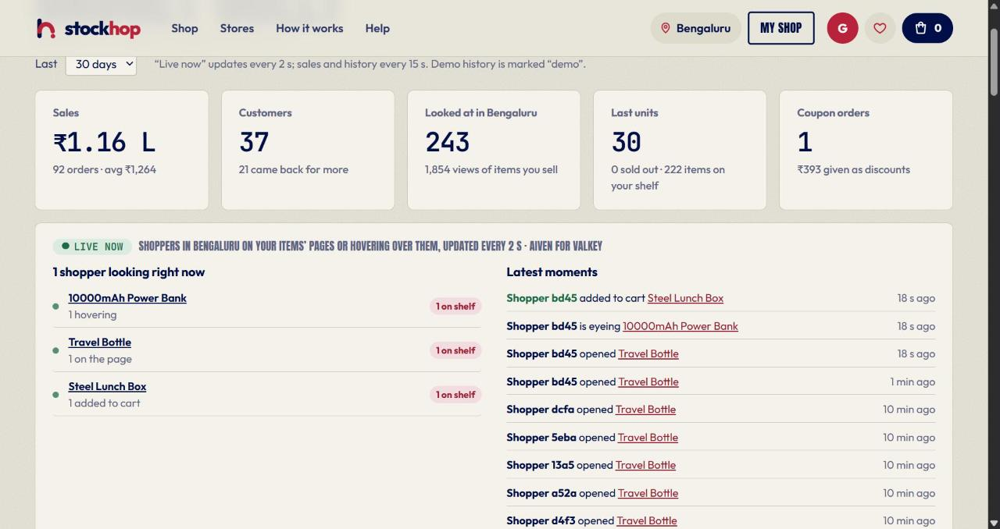

</td>
</tr>
</table>

<div align="center">

**Store console: proof that what shoppers see matches the database**<br>
<sub>Every product × city in the search index is compared with PostgreSQL, alongside outbox depth, Kafka consumer lag and worker heartbeats.</sub>

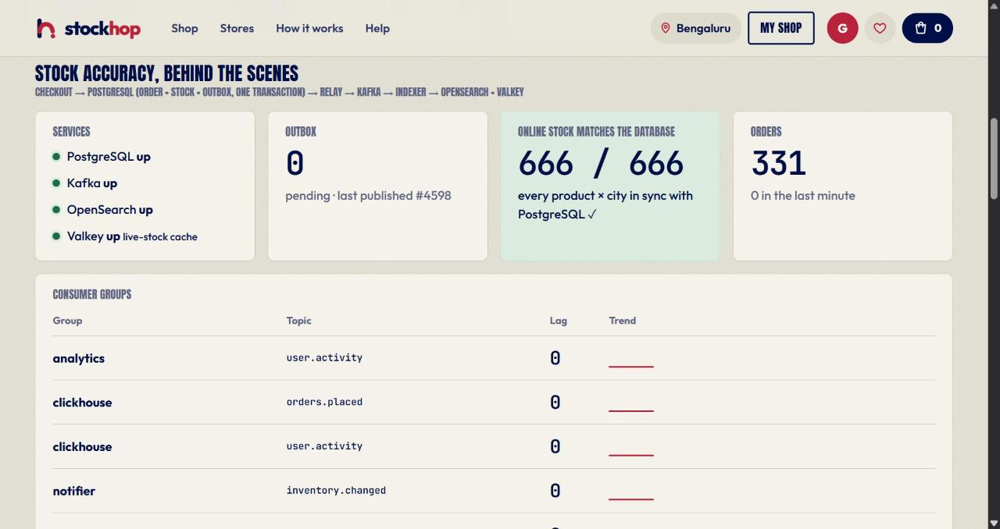

</div>

## How it works

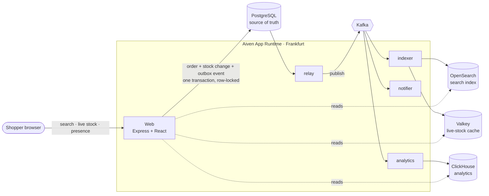

**PostgreSQL decides. Kafka carries the facts. Everything else is a fast copy that heals itself.**

- **Checkout** needs only PostgreSQL. The order, the stock change and an outbox event commit together, so an order is never lost and never sold twice.
- **The outbox relay** publishes those events to Kafka. Separate consumer groups keep **OpenSearch** and **Valkey** in step (version-guarded, so replays and duplicates are harmless), send confirmations and alerts, and feed **ClickHouse** for analytics.
- **Shoppers read** live stock from Valkey (about 2 ms) and search from OpenSearch. **Retailers read** sales and customers from ClickHouse and live presence from Valkey.

Full design: [`doc/03-architecture.md`](doc/03-architecture.md) · data model and events: [`doc/04-data-model-and-events.md`](doc/04-data-model-and-events.md)

## Measured, not claimed

Every number below comes from a script in this repo, run against real Aiven services. Most were run on the live deployment.

| What we tested | Result | Details |
|---|---|---|
| 50 shoppers race for 5 units (3 rounds) | **0 oversold**, 15 of 150 succeed; no deadlocks, no partial carts | [doc/12](doc/12-metrics.md) |
| Checkout stampede on the live site: 40 shoppers, 5 units | **Exactly 5 orders**, checkout p50 **0.53 s**, 0 errors | [doc/15](doc/15-load-test.md) |
| 10 identical submits at once | **1 order**, stock −1 | [doc/12](doc/12-metrics.md) |
| Live stock: Valkey vs the original OpenSearch-only path | server p50 **~330 ms → ~2 ms**; OpenSearch search load → 0 | [doc/15](doc/15-load-test.md) |
| Event pipeline switched off mid-shopping | Checkout kept working, **nothing lost**, everything caught up on restart | [doc/15](doc/15-load-test.md#outage-drill-the-event-pipeline-switched-off-on-the-live-site) |
| Restock → shoppers' screens | **1.0–1.2 s** end to end (PostgreSQL → Kafka → Valkey) | [doc/15](doc/15-load-test.md) |
| 50 people typing in search at once | **64 req/s**, server p50 **103 ms**, p99 **2.5 s** (was 10.4 s) | [doc/15](doc/15-load-test.md#new-shopping-features-doc21-type-ahead-shops-presence-bought-together) |
| Partner storefronts under load | found a database-pool bottleneck; after the fix **4.8× throughput** (p50 3.8 s → 0.37 s) | [doc/15](doc/15-load-test.md#what-the-test-found-and-the-fix) |

## Features

**Shoppers**
- Live per-city stock on every card, with the nearest city that has it when yours is out
- Search like you talk: typos, synonyms, price and occasion from a sentence, and meaning search with a small embedding model
- Suggestions as you type, trending searches, recent searches, sorting and "Show more"
- Product pages with specs, partner offers, similar items on the shelf, frequently bought together and recently viewed
- Saved items, back-in-stock alerts, optional passwordless accounts with one cart across devices
- Checkout with Razorpay **Test Mode** and stock holds, so no real money moves

**Partner retailers**
- A storefront at `/store/<shop>` with search inside the shop
- A private dashboard: sales, regular customers, last units, coupons for their regulars, and shoppers live on their items

**Store operations** (`/ops`)
- Missed demand (who we turned away, for what, and whether they bought anyway) and a restock list
- Search-index sync check, outbox, Kafka lag and worker health
- Shopper analytics: funnel, top searches, searches with no results, suggestions taken

## Run it locally

You need Node 20+ and the Aiven services listed above ([`doc/10-aiven-setup.md`](doc/10-aiven-setup.md) walks through creating them).

```bash
npm install
cp .env.example .env          # add your Aiven service URLs (never commit .env)
                              # put the Aiven CA / Kafka certificates in ./certs (git-ignored)
npm run smoke                 # checks PostgreSQL, Kafka and OpenSearch connectivity
npm run kafka:topics          # creates the Kafka topics
npm run demo:reset            # migrate, create the search index, seed the catalogue
npm run dev                   # API + workers + web on http://localhost:5173
```

Demo shop logins are passwordless (the sign-in code is shown on screen in the demo): see [`doc/18-retailer-accounts.md`](doc/18-retailer-accounts.md).

**Tests and drills**

```bash
npm test                      # unit tests
npm run typecheck
npm run test:concurrency      # races, deadlocks, idempotency, pipeline → rewrites doc/12
npm run load:test             # live-site load test (add --only=new for the newest features)
npm run drill:outage          # pipeline outage drill
```

## Documentation

| | |
|---|---|
| [Requirements traceability](doc/01-requirements-traceability.md) | Every requirement in the brief, mapped to code and proof |
| [Architecture](doc/03-architecture.md) | Components, flows, consistency model, failure modes |
| [API](doc/05-api-spec.md) | Every endpoint, request and response |
| [Concurrency metrics](doc/12-metrics.md) · [Load test](doc/15-load-test.md) | What we measured and what we fixed because of it |
| [Payments and the two-laptop demo](doc/13-payments-and-demo.md) | Razorpay Test Mode with stock holds |
| [Analytics](doc/14-analytics.md) · [Customers on ClickHouse](doc/16-customers-clickhouse.md) | Clickstream through Kafka; retailer dashboards |
| [Search like you talk](doc/19-search-and-pitch.md) · [Shopping features](doc/21-shopping-features.md) | Search, suggestions, shops, live presence, bought together |

Everything else is indexed in [`doc/README.md`](doc/README.md).

## Disclosure (rule 7: third-party resources & AI tools)

| Kind | What | Used for |
|---|---|---|
| Managed services | Aiven for PostgreSQL, Apache Kafka, OpenSearch, Valkey and ClickHouse; Aiven App Runtime (trial credits) | Required by the brief; hosting |
| Hosting (earlier) | Vercel (Hobby), used before moving to Aiven App Runtime | Storefront + API |
| Libraries | express, pg, kafkajs, @opensearch-project/opensearch, ioredis, zod, dotenv, cookie-parser, react, react-dom, react-router-dom, @huggingface/transformers, lenis · dev: typescript, tsx, vite, @vitejs/plugin-react, vitest, concurrently (all MIT / Apache-2.0 / BSD) | App code |
| Model | `Xenova/all-MiniLM-L6-v2` sentence embeddings (Apache-2.0), run inside the web process | Meaning search |
| Animation | GSAP 3.13 with ScrollTrigger (GreenSock, free "Standard No-Charge" licence) | UI motion |
| AI tools | **Qwen Studio (Qwen AI)** | Research, content, presentation (mandatory, rule 11A) |
| IDE | **Google Antigravity** | All coding (mandatory, rule 11B) |
| Fonts | Outfit, Anton, Caveat, JetBrains Mono (Google Fonts, OFL) | UI |
| Product photos | Free stock photos (Unsplash / Pexels licence); each photographer is credited in [`web/src/productPhotos.ts`](web/src/productPhotos.ts). Fallback product illustrations are our own SVGs | Product images |
| Cut-out images | Wikimedia Commons, unmodified: Vijay Verma (CC0), Trent Huss (CC BY-SA 4.0, two files), PantheraLeo1359531 (CC BY-SA 4.0), SeriouslyBored (CC0). Credited with links under the home page's commute kit and in `productPhotos.ts` | Floating images in the commute kit |

Product names and brands in the demo catalogue are fictional placeholders, as are the brands Pulse Audio, Lumen Sound, Kinetic, Volt Works, Nest and Co and Trail Line, and the partner retailers (Gadget Gully, Echo & Ohm, Volt Bazaar, Tune Street, Circuit Corner, Byte Bazaar).

## Security

Credentials are read from environment variables only. `.env` and `certs/` are git-ignored; see [`.env.example`](.env.example) for the variable names. Customer emails are masked in retailer dashboards, and shoppers appear there only as short anonymous tags.
