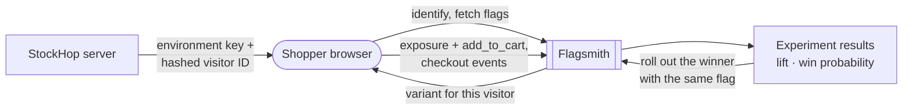

<div align="center">

# StockHop × Flagsmith

### Do reviews make shoppers add to cart?

An A/B test on a real online store, run with **Flagsmith feature flags** and **Flagsmith Experimentation**.

Team **Dark Launchers** · Toggle Wars: The Flagsmith Experimentation Hackathon (WeMakeDevs) · 26–29 Nov 2026 · Track 01, Test Something Real

</div>

---

## The experiment

StockHop is a city-aware online store: every product shows how many are on the shelf in your city, live, and the last unit can never be sold twice. Its product page shows price, stock and partner shop offers, but nothing about what other shoppers think.

Big marketplaces lead with reviews. Do they earn their place on a local store's product page? We test it.

| | |
|---|---|
| **Hypothesis** | Showing reviews on the product page raises the share of shoppers who add to cart by at least 10% |
| **Flag** | `product_trust_signal`, multivariate, split 50 / 50 |
| **Versions** | **control** (today's page) · **reviews** (stars, count and a recent review under the price, plus a full reviews section where shoppers can write their own) |
| **Primary metric** | `add_to_cart`, per shopper |
| **Secondary and guardrail** | `checkout_started`, `checkout_completed` and order revenue |
| **Decision rule** | Ship reviews at ≥ 95% win probability with no revenue loss; otherwise keep control |
| **Traffic** | Real shoppers on the live store, plus simulated shoppers (`npm run traffic:sim`) reported separately |

We also designed a third version, "N bought in your city this week". We measured it before launch: it would have shown on only about 20% of products, so we cut it rather than run a diluted test. Full plan, what we cut and why, limitations and results: [doc/experiment.md](doc/experiment.md)

## How we use Flagsmith



- **One identity for flags and events.** The server gives each browser a one-way hash of its session, which Flagsmith uses as the identity. A shopper keeps their variant for the whole visit, even if they sign in.
- **Exposure is recorded where the change is seen.** `useVariant()` is called only in the component that renders the difference.
- **Conversions come from real store events:** add to cart from anywhere, placing an order, a confirmed order (with its total), and back-in-stock alerts.
- **The winner ships with the same flag.** No redeploy is needed.
- **Fails safe.** With no key set, or if Flagsmith is unreachable, everyone sees control and the store works as before.

Setup, code map, flags and events: [doc/flagsmith.md](doc/flagsmith.md)

## Run it

```bash
npm install
cp .env.example .env     # Aiven service URLs + FLAGSMITH_ENVIRONMENT_KEY
npm run demo:reset       # database, search index and catalogue
npm run reviews:seed     # demo reviews
npm run dev:app          # http://localhost:5173
```

Preview the reviews version locally with `?ff_product_trust_signal=reviews` on any product page.

Requirements, deployment and checks: [doc/setup.md](doc/setup.md)

## Built with

- **Flagsmith**: feature flags and Experimentation (`@flagsmith/flagsmith` 12.4.0)
- **Aiven**: PostgreSQL, Apache Kafka, OpenSearch, Valkey, ClickHouse and App Runtime
- **App**: TypeScript, Express, React, Vite

How the pieces fit together: [doc/architecture.md](doc/architecture.md)

## Team Dark Launchers

Somya (lead) · Pradhyumna Kudtherkar · Zaiba Firdous · Abhishek M Shivanagoudar

## Credits

- StockHop was first built for Build Bengaluru 2.0 (21–22 Nov 2026), [original repository](https://github.com/abhishiv17/Stockhop). Everything after the `stockhop-base` tag was built for this hackathon.
- Libraries: express, pg, kafkajs, @opensearch-project/opensearch, ioredis, zod, react, react-router-dom, @huggingface/transformers, lenis, GSAP (GreenSock Standard No-Charge licence), @flagsmith/flagsmith.
- Embedding model: `Xenova/all-MiniLM-L6-v2` (Apache-2.0).
- Product photos: Unsplash and Pexels, each photographer credited in [`web/src/productPhotos.ts`](web/src/productPhotos.ts). Cut-out images: Wikimedia Commons, by Vijay Verma (CC0), Trent Huss (CC BY-SA 4.0), PantheraLeo1359531 (CC BY-SA 4.0) and SeriouslyBored (CC0).
- Fonts: Outfit, Anton, Caveat and JetBrains Mono (Google Fonts, OFL).
- Product names, brands, partner shops and the starting reviews in the demo catalogue are fictional. Reviews written on the site are stored separately.
- AI coding assistants were used, as allowed by the hackathon rules.

## Security

Credentials come from environment variables only. `.env` and `certs/` are git-ignored; [`.env.example`](.env.example) lists the variable names.
