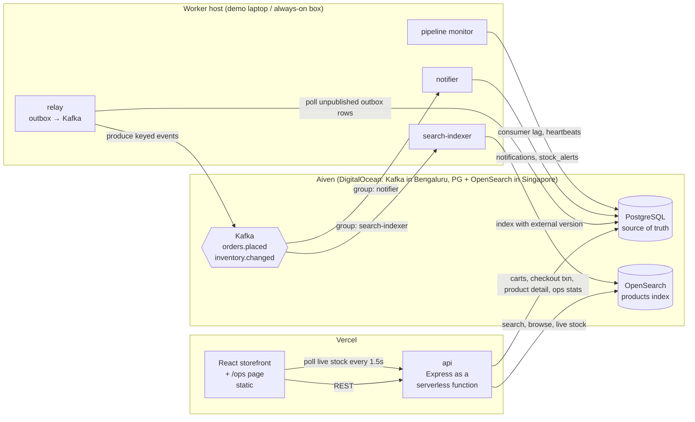

# 03: Architecture

## 1. System overview



**The rule:** PostgreSQL decides, Kafka carries the facts, OpenSearch holds a copy for search.
**Deployment rule:** the Vercel API never connects to Kafka. Checkout writes the outbox (PG); everything Kafka-related runs on the worker host.

## 2. Processes

| Process | Entry | Responsibility | Where | Scales? |
|---|---|---|---|---|
| `api` | `api/index.ts` → `server/app.ts` | REST, search, live-stock reads, checkout transaction, ops summary | **Vercel** (local: `server/dev.ts`) | Yes (stateless). Watch PG connections (limit 15) |
| `relay` | `server/workers/relay.ts` | Publishes outbox rows to Kafka in `id` order | Worker host | **Exactly one instance** (preserves per-key order) |
| `indexer` | `server/workers/indexer.ts` | `inventory.changed` → OpenSearch upsert with external version | Worker host | Up to #partitions (2) |
| `notifier` | `server/workers/notifier.ts` | `orders.placed` → confirmation; `inventory.changed` → low-stock alert | Worker host | Up to #partitions (2) |
| `monitor` | `server/workers/monitor.ts` | Every 2 s: consumer lag per group (Kafka admin) + worker heartbeats → `pipeline_stats` table | Worker host | One |
| `web` | `web/` (Vite) | Storefront, cart, checkout, order page, `/ops` | **Vercel** (static) | Static |

`server/workers/index.ts` starts relay, indexer, notifier and monitor in one process. `--only=indexer` etc. starts just one, so the demo can **kill the indexer on stage** while the others (and checkout) keep working.

## 3. Invariants (never violate these)

| ID | Invariant | Enforced by |
|---|---|---|
| I-1 | Every change to `inventory` writes an outbox row **in the same transaction** | Single helper `changeStock(tx, …)`; the only code path that touches `inventory.qty` |
| I-2 | Only PostgreSQL allocates stock. Consumers **never** write `inventory` | Code review; consumers have no import of `changeStock` |
| I-3 | `inventory.qty` never goes below 0 | Conditional `UPDATE … WHERE qty >= n` **and** `CHECK (qty >= 0)` as a backstop |
| I-4 | `inventory.version` strictly increases on every change, **across demo resets too** | `version = nextval('inventory_version_seq')` in the same `UPDATE`; the sequence is never reset, so replayed old events always lose |
| I-5 | An OpenSearch doc is never overwritten by an older version | `version_type: external` (409 = already newer → treat as success) |
| I-6 | Consumers are idempotent: processing an event twice has the same effect as once | Indexer: I-5. Notifier: `UNIQUE (event_id)` on its tables |
| I-7 | No secrets in git | `.gitignore` + `.env.example` + pre-commit check |

## 4. Core flows

### 4.1 Checkout (the most important code in the repo)

```mermaid
sequenceDiagram
    participant B as Browser
    participant A as api
    participant P as PostgreSQL
    B->>A: POST /api/checkout {city, customer, idempotencyKey}
    A->>P: BEGIN (READ COMMITTED)
    A->>P: SELECT order WHERE idempotency_key = $k
    alt already exists
        A-->>B: 200 existing order (no double charge)
    end
    A->>P: load active cart items + current prices, ORDER BY product_id
    loop each item, sorted by product_id
        A->>P: UPDATE inventory SET qty=qty-n, version=nextval(seq)<br/>WHERE product_id=$p AND city_code=$c AND qty>=n<br/>RETURNING qty, version
        alt 0 rows updated
            A->>P: ROLLBACK
            A-->>B: 409 OUT_OF_STOCK {items:[{productId, requested, available}]}
        end
    end
    A->>P: upsert customer; INSERT orders, order_items (price snapshot)
    A->>P: INSERT outbox: InventoryChanged × items, OrderPlaced × 1
    A->>P: UPDATE carts SET status='checked_out'
    A->>P: COMMIT
    A-->>B: 201 {orderId, orderNumber}
```

**Why this can't oversell (be able to say this to a judge):**
The `UPDATE` takes a row lock on `(product_id, city)`. If shopper B's transaction arrives while A holds the lock, B **waits**. When A commits, PostgreSQL re-evaluates B's `WHERE qty >= n` against the **new** row (READ COMMITTED re-check). With qty now 0, B updates 0 rows and rolls back. There is no read-then-write gap because the check and the write are a single statement. `CHECK (qty >= 0)` is a second line of defence.

**Why items are sorted by `product_id`:** two multi-item carts locking rows in different orders could deadlock. A consistent order prevents it.

**Idempotency race:** two identical requests could both miss the initial `SELECT`. The `UNIQUE(idempotency_key)` makes the second `INSERT` fail. We catch `23505`, roll back, re-read the order and return it.

### 4.2 Relay (outbox → Kafka)

```
loop every 200 ms:
  BEGIN
  SELECT id, topic, msg_key, event_type, payload, created_at
    FROM outbox WHERE published_at IS NULL
    ORDER BY id LIMIT 100
    FOR UPDATE SKIP LOCKED
  producer.send(topic, messages with key=msg_key, acks=-1)   # grouped by topic, order kept
  UPDATE outbox SET published_at = now() WHERE id = ANY($ids)
  COMMIT
```

- **Crash after send, before commit** → rows get re-sent → duplicates. This is fine because of I-6. At-least-once delivery with an exactly-once **effect**.
- **Kafka down** → send throws → rollback → rows stay unpublished → retried next tick. Checkout is unaffected; `/ops` shows "outbox pending: N".
- **One relay only.** `ORDER BY id` with one relay preserves per-key order. Two relays with `SKIP LOCKED` could reorder events for the same key, and I-5 would still protect the index. We still run one, and say why.
- Optional latency boost: `LISTEN outbox_new` / `pg_notify` in the checkout txn to wake the relay right away instead of waiting ≤200 ms. Only if time allows.

### 4.3 Search indexer

```
consumer group "search-indexer", topic inventory.changed, fromBeginning: true
eachMessage(e):
  doc = e.payload.doc + { qty, in_stock: qty > 0, stock_version: version }
  retry with backoff (1s → 10s, call heartbeat() between tries):
    opensearch.index({ index: 'products', id: `${product_id}_${city_code}`,
                       version: e.payload.version, version_type: 'external', body: doc })
    409 version_conflict → success (we already have this or newer)
  return → offset committed
```

- **Event-carried state:** `InventoryChanged` carries the **full** product×city document (name, brand, price, tags…). The indexer never queries PG. This is why external versioning works: OpenSearch's `index` replaces the whole doc, and partial `update` can't use external versions.
- **OpenSearch down** → handler keeps retrying, offsets aren't committed, lag grows (visible on `/ops`). When it recovers, the consumer drains. This is the "kill/outage drill".

### 4.4 Notifier

- `orders.placed` → `INSERT INTO notifications (event_id UNIQUE, order_id, channel='email', recipient, body) ON CONFLICT DO NOTHING` → log "📧 Confirmation sent to a***@gmail.com for SH-BLR-1042". No real email: it's simulated, and we say so.
- `inventory.changed` where `qty <= LOW_STOCK_THRESHOLD (2)` → `INSERT INTO stock_alerts … ON CONFLICT (event_id) DO NOTHING`.
- Order page polls `GET /api/orders/:id` until `confirmationSent: true`, so the consumer's effect appears in the shopper's own UI.

### 4.5 Live stock on screen (polling the search index)

Vercel functions can't hold a Kafka consumer or a long-lived SSE stream, so live updates **read the OpenSearch index**, the thing Kafka keeps fresh:

- Every 1.5 s the browser calls `GET /api/stock?city=BLR&ids=1,2,3…` for the cards on screen (one OpenSearch `mget`, ~24 ids).
- A card flips (with a yellow flash) **only if** `stock_version > card.version` (same rule as the index).
- **This makes the demo more honest, not less:** the flip literally *is* "Kafka event → consumer → search index update" (slide 5). When we kill the indexer (Drill 2), the cards **stop updating** while checkout keeps working; on restart they catch up. The audience sees the pipeline, not a shortcut around it.
- Cost: 2 demo tabs × 1 req/1.5 s is trivial for OpenSearch and well within Vercel's function limits. Polling pauses when the tab is hidden (`document.visibilityState`).

### 4.6 Pipeline monitor (feeds `/ops`)

The Vercel API can't ask Kafka for consumer lag, so the worker host does it and writes the results to PG:
- Every 2 s: `admin.fetchTopicOffsets` + `admin.fetchOffsets` for groups `search-indexer` and `notifier` → `pipeline_stats('lag:<group>:<topic>')`.
- Each worker upserts `heartbeat:<name>` every 2 s. `/ops` shows a worker as **down** when its heartbeat is older than 6 s.
- The monitor runs in its own loop, so when the indexer is killed, its lag keeps being reported and **climbs on screen**.
- If the whole worker host is down, `/ops` says so (all heartbeats stale) and checkout still works.

### 4.7 Search & browse

- Browse = OpenSearch `match_all` + filters (city required). Product detail = PG (authoritative) + stock in all 3 cities.
- Query design and mapping are in [04 §3](./04-data-model-and-events.md#3-opensearch).
- Every response includes `tookMs` from OpenSearch for the "fast" badge.

## 5. Consistency model (one slide, one answer)

| Data | Consistency | Where |
|---|---|---|
| Stock allocation, orders, carts | **Strong** (ACID, row locks) | PostgreSQL |
| Search results / listing stock counts | **Eventual**, typically < 1 s | OpenSearch via Kafka |
| Live card updates | Eventual (index refresh ~1 s + poll 1.5 s), version-guarded | Browser polls OpenSearch via `/api/stock` |

A shopper may briefly **see** "1 left" after it sold. They can never **buy** it. Checkout always asks PG.

## 6. Failure modes & what happens

| Failure | Checkout | Search | Recovery | Demo? |
|---|---|---|---|---|
| OpenSearch down | ✅ works | ❌ search errors (UI shows friendly message; detail pages still work from PG) | Indexer retries; lag drains when it returns | Drill 2 (we kill the indexer, a safe stand-in) |
| Indexer process dead | ✅ | Stale counts | Restart → resumes from committed offset | **Drill 2** |
| Kafka down | ✅ (outbox accumulates) | Stale | Relay publishes backlog when Kafka returns | Spoken |
| Relay dead | ✅ | Stale | Restart → publishes all `published_at IS NULL` | Spoken / optional |
| Crash mid-relay | ✅ | — | Duplicate events, harmless (I-6) | **Drill 3 (replay)** |
| 50 concurrent buyers, 5 units | 5 ✅, 45 × 409 | Correct after drain | — | **Drill 1** |
| Duplicate checkout submit | Same order returned | — | Idempotency key | Spoken |
| PG down | ❌ (correctly: no truth, no sale) | Search still works (read-only) | Aiven | Spoken |

## 7. Why Kafka never deducts stock

The brief's example says *"order placed → a listener reduces inventory count"*. We deliberately don't do that:

> If a Kafka consumer deducted stock **after** the order was accepted, two checkouts could both succeed before the consumer runs. That's an oversell window. So **allocation happens synchronously in PostgreSQL, once, under a row lock**. Kafka carries the **fact** of the change, never the **decision**. The consumer updates the **inventory view** that shoppers search. Search is eventually consistent; allocation is strongly consistent.

## 8. Why Kafka at all (the counterfactual)

"Why not just update OpenSearch inside the checkout handler?"

| Problem with a direct write | With outbox → Kafka |
|---|---|
| OpenSearch slow/down → checkout fails or the index silently goes stale | Checkout never touches OpenSearch |
| Crash between PG commit and index write → update lost forever | Event committed with the order; relay re-sends |
| Every new side-effect (email, alerts, live UI) = more code + failure modes inside checkout | New consumer group, **zero** checkout changes (we have 3) |
| Rebuilding the index needs a custom script | Reset the consumer group offset → replay (Drill 3) |

## 9. Why outbox instead of Kafka Connect / CDC

1. **Dual-write problem:** writing to PG and then producing to Kafka in app code can lose events on a crash. The outbox makes the event part of the PG transaction.
2. **Fewer moving parts.** Our Developer-tier Kafka *can* run Connect, but Debezium needs logical replication setup, a separate Connect service and more credits. The outbox gives the same no-lost-event guarantee in ~60 lines we can explain line by line. CDC is our "next step" answer.

## 10. Decision log (ADRs, short form)

| # | Decision | Alternatives rejected | Reason |
|---|---|---|---|
| ADR-1 | Conditional `UPDATE … WHERE qty >= n` | `SELECT … FOR UPDATE` then `UPDATE`; `SERIALIZABLE` | One statement, no retry loop, same safety |
| ADR-2 | Transactional outbox + single relay | Produce in handler; Kafka Connect / Debezium | Dual-write safety; far simpler than CDC in 24 h |
| ADR-3 | One OpenSearch doc per product × city | One doc per product with nested city stock | Clean per-city external versioning; trivial city filter; matches slide 6 |
| ADR-4 | Full-doc events (event-carried state) | Indexer reads PG | Indexer independent of PG; enables external versioning |
| ADR-5 | Session-cookie guest carts | Accounts/login | Out of scope in 24h; brief doesn't require auth |
| ADR-6 | Live stock = browser polls `/api/stock` (OpenSearch `mget`) | SSE / WebSockets from a Kafka consumer | Vercel functions can't host consumers or long streams; polling the index shows the real pipeline (§4.5) |
| ADR-7 | **TypeScript** (strict) everywhere; `tsx` runs server code, Vite builds web | JavaScript | Team decision, 21 Nov. Shared types between API and UI |
| ADR-8 | `kafkajs` client | `@confluentinc/kafka-javascript` | Pure JS, no native build on Windows laptops, mTLS works with Aiven. Unmaintained upstream, which is acceptable for 24h |
| ADR-9 | 2 Kafka topics, 2 partitions (+ `smoke`) | Topic per event type ×N | Enough for keyed ordering; Developer tier allows 20 topics |
| ADR-10 | Index alias `products` → `products_v1`, 1 shard, 0 replicas | Defaults | Single node; alias allows blue/green reindex |
| ADR-11 | **Vercel** for web + API; workers on a separate long-running host | Everything on one VM; everything on Vercel | Team wants a Vercel deployment; Kafka consumers need a persistent process. Outbox means the API needs no Kafka |
| ADR-12 | Aiven **Developer tier** for all 3 (paid from $50 trial credits, no card) | Free tier | Developer services aren't powered off when idle, so they'll be up at judging; fewer limits. ~$1–5 of credit for the event |
| ADR-13 | `PG_POOL_MAX=5` per function instance | Default pool (10) | Aiven Developer PG allows **15 connections** total; Vercel can run several instances |
| ADR-14 | No Supabase | Supabase for test DB | Brief requires Aiven PG. Tests use a separate `stockhop_test` database on the same Aiven service |

## 11. Scale path (spoken answer only, not built)

Product×city docs shard naturally. `inventory.changed` keyed by `product:city` keeps per-key ordering as partitions grow. Add indexer instances up to the partition count. The relay scales by partitioning the outbox by key hash. PG hot rows (a flash-sale SKU) → split stock into N sub-rows ("stock buckets") if one row lock becomes the bottleneck.

## 12. Repository layout

One npm package at the root (simplest for Vercel). TypeScript throughout.

```
Stockhop/
├── README.md               project overview + disclosure
├── .env.example            every env var, no values
├── package.json            scripts + all deps
├── tsconfig.json           server-side TS (server/, api/, scripts/), NodeNext
├── vite.config.ts          web root = web/, builds to dist/, dev proxy /api → :4000
├── vercel.json             /api/* → api/index.ts; everything else → SPA
├── certs/                  (git-ignored) Aiven CA + Kafka client cert/key
├── doc/                    these docs + brief + submission PDFs
├── api/
│   └── index.ts            Vercel function: export default createApp()
├── server/
│   ├── config.ts           env loading + validation (lazy per service)
│   ├── app.ts              Express app (routes mounted here)
│   ├── dev.ts              local API server
│   ├── lib/                db.ts, kafka.ts, search.ts, log.ts, events.ts
│   ├── domain/             stock.ts (changeStock), checkout.ts, cart.ts
│   ├── routes/             search.ts, products.ts, cart.ts, checkout.ts, orders.ts, stock.ts, ops.ts, admin.ts
│   ├── workers/            index.ts, relay.ts, indexer.ts, notifier.ts, monitor.ts
│   └── db/migrations/      001_init.sql
├── scripts/                smoke.ts, migrate.ts, seed.ts, search-init.ts, reindex.ts,
│                           stampede.ts, replay.ts, restock.ts
└── web/
    ├── index.html, tsconfig.json
    └── src/                main.tsx, App.tsx, pages/, components/, lib/api.ts, styles/tokens.css
```

## 13. Deployment topology

| Piece | Runs on | Needs |
|---|---|---|
| Storefront + `/ops` (static) | Vercel | nothing |
| API (`/api/*`) | Vercel serverless (Node) | `DATABASE_URL`, `PG_CA_CERT` (PEM text), `OPENSEARCH_URL`, `ADMIN_TOKEN` |
| relay, indexer, notifier, monitor | Demo laptop (`npm run workers`), or later any always-on host (Railway/Render/VM) | PG + Kafka (mTLS certs) + OpenSearch |
| Data | Aiven: Kafka `do-blr` (Bengaluru), PG + OpenSearch `do-sgp` (Singapore) | |

If the worker host goes offline, the deployed site **still takes orders** (outbox fills up) and search shows the last indexed stock. When workers come back, everything catches up. That's Drill 2, at deployment scale.
