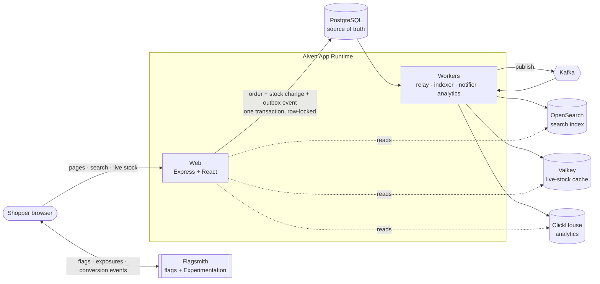

# Architecture

StockHop is a city-aware online store: stock is counted per city, shown live, and the last unit can never be sold twice. Flagsmith sits on top of it and decides which version of a page each shopper sees.

## Overview

## Flagsmith

- The **web server** only hands the browser its Flagsmith environment key and a hashed visitor ID (`GET /api/experiments/config`). It never calls Flagsmith itself.
- The **browser** fetches flags for that visitor, renders the matching variant, and sends exposures and conversion events straight to Flagsmith.
- **Flagsmith Experimentation** stores the events in its warehouse and works out lift and win probability for each variant.
- If Flagsmith is unreachable or no key is set, every shopper gets the control version. Shopping never waits on Flagsmith.

Details: [flagsmith.md](flagsmith.md).

## The store

**PostgreSQL decides. Kafka carries the facts. Everything else is a fast copy that heals itself.**

- **Checkout needs only PostgreSQL.** Adding to a cart locks the stock row (`SELECT … FOR UPDATE`) and counts what other carts already hold, so two shoppers can't both get the last unit. The order, the stock change and an outbox event commit in one transaction, so an order is never lost.
- **The outbox relay** publishes those events to Kafka. Separate consumer groups keep **OpenSearch** (search) and **Valkey** (live stock) in step, send alerts, and feed **ClickHouse** (sales and analytics). Updates are version-guarded, so replays and duplicates do no harm.
- **Shoppers read** live stock from Valkey and search from OpenSearch. **Partner retailers read** sales and customers from ClickHouse.
- **Shopper activity** (page views, clicks, searches) is batched by the browser, written to the outbox and sent through Kafka like every other event. Only a one-way hash of the session is stored.

## Code layout

| Path | What's there |
|---|---|
| `web/src/` | React storefront. `experiments.tsx` is the only file that knows about Flagsmith |
| `server/routes/` | HTTP API. `experiments.ts` serves the Flagsmith config |
| `server/domain/` | Stock, checkout, accounts, activity |
| `server/workers/` | Outbox relay, search indexer, notifier, analytics |
| `server/db/migrations/` | PostgreSQL schema |
| `scripts/` | Setup, seeding, load tests and drills |
