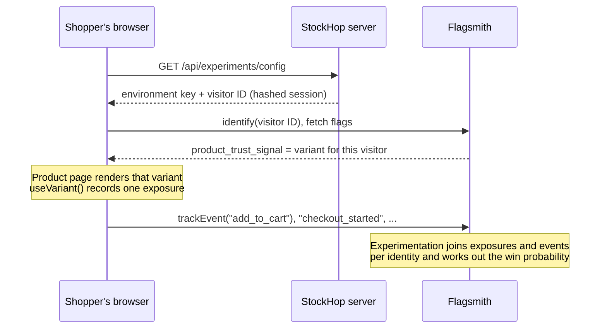

# How StockHop uses Flagsmith

StockHop decides which version of a page a shopper sees with **Flagsmith feature flags**, and measures which version wins with **Flagsmith Experimentation**. This page covers setup, the code, and how to read and act on the results.

The experiment itself (hypothesis, versions, metrics, decision rule) is in [experiment.md](experiment.md).

## How it fits together



1. **The server hands out the identity.** `GET /api/experiments/config` returns Flagsmith's client-side environment key and a visitor ID. The visitor ID is the same one-way hash of the session cookie that StockHop's own clickstream already uses, so Flagsmith's buckets and our analytics describe the same people. It is tied to the browser, not the account, so a shopper keeps their variant if they sign in halfway through a visit.
2. **The browser starts Flagsmith once** with that identity and `enableEvents: true`.
3. **Pages ask for a variant** with `useVariant(flag, variants)`. Calling it records the exposure, so it is called only in the component that shows the difference.
4. **Conversions are sent with `trackConversion(event)`** at the moments listed below.

If no key is set, or Flagsmith can't be reached, every shopper gets the control version and nothing is sent. The store keeps working either way.

## Code map

| File | What it does |
|---|---|
| [`server/routes/experiments.ts`](../server/routes/experiments.ts) | `GET /api/experiments/config`: environment key and visitor ID |
| [`web/src/experiments.tsx`](../web/src/experiments.tsx) | Starts Flagsmith; `ExperimentsProvider`, `useVariant`, `trackConversion`; flag and event names |
| [`web/src/main.tsx`](../web/src/main.tsx) | Wraps the app in `ExperimentsProvider` |
| [`web/src/state.tsx`](../web/src/state.tsx) | `add_to_cart` after a successful add (every add goes through here) |
| [`web/src/pages/Checkout.tsx`](../web/src/pages/Checkout.tsx) | `checkout_started` and `checkout_completed` (with the order total) |
| [`web/src/components/NotifyMe.tsx`](../web/src/components/NotifyMe.tsx) | `back_in_stock_alert` |
| [`web/src/pages/Product.tsx`](../web/src/pages/Product.tsx) | Reads `product_trust_signal` and renders control or reviews |
| [`web/src/components/Reviews.tsx`](../web/src/components/Reviews.tsx) | The reviews version; `review_submitted` |
| [`server/routes/reviews.ts`](../server/routes/reviews.ts) | `GET`/`POST /api/products/:id/reviews` |
| [`scripts/simulate-traffic.ts`](../scripts/simulate-traffic.ts) | Simulated shoppers (`npm run traffic:sim`) |

The SDK is `@flagsmith/flagsmith` 12.4.0, pinned exactly (the first version with Experimentation support).

## Flags

| Flag | Type | Variants | Where it's read |
|---|---|---|---|
| `product_trust_signal` | Multivariate | control, `reviews` | Product page |

Code branches on the **variant label**, not the value, so labels must be set on every variation in Flagsmith. A variation created through the API without a label is not counted.

## Conversion events

Event names are case-sensitive and must match the metric in Flagsmith exactly. An event with no matching metric is dropped silently.

| Event | Fired when | `value` | Suggested metric |
|---|---|---|---|
| `add_to_cart` | An item is added to the cart from anywhere (product page, card, "bought together") | none | **Occurrence, higher is better (primary)** |
| `checkout_started` | The shopper presses "Place order" (our cart or a partner shop's item) | none | Occurrence, higher is better |
| `checkout_completed` | The order is confirmed | Order total in rupees | Occurrence (conversion) and Sum (revenue), higher is better |
| `back_in_stock_alert` | A shopper asks to be told when a sold-out item is back | none | Occurrence, informational |
| `review_submitted` | A shopper posts a review (reviews version only) | Star rating | Occurrence, informational |

Flagsmith counts a conversion only after that identity's first exposure, so an add to cart before the shopper ever saw the product page doesn't count.

## Setting it up

### 1. Flagsmith account and environments
1. Create an organisation and project on [Flagsmith Cloud](https://app.flagsmith.com) with **two environments**:
   - **Production**: the live store. Only real shoppers.
   - **Simulation**: only simulated shoppers (`npm run traffic:sim`). It has its own copy of the flag, metrics and experiment, so simulated traffic can never mix into the real result.
2. In **each** environment, **Environment settings → Warehouse:** enable the managed **Flagsmith** warehouse. Experiments can't be created, and events are rejected, until a warehouse is connected. The first events can take a few hours to appear, so do this early.
3. Copy each environment's **client-side** SDK key. Install the [Flagsmith CLI](https://docs.flagsmith.com/integrating-with-flagsmith/CLI) v2 and run `flagsmith login` once: `npm run exp` sends its requests through `flagsmith api` with that login.

### 2. Tell StockHop about it
Set this on the web app (Aiven App Runtime variables, or `.env` locally):

```bash
FLAGSMITH_ENVIRONMENT_KEY=<Production client-side key>     # web app + local .env
FLAGSMITH_SIM_ENVIRONMENT_KEY=<Simulation client-side key> # local .env only (traffic:sim)
# FLAGSMITH_API_KEY=<Organisation API key>                 # optional: npm run exp uses the CLI login by default
```

Only `FLAGSMITH_ENVIRONMENT_KEY` goes on the deployed web app. The environment key is public by design: it is sent to every browser. It is served at runtime, so changing it needs a restart, not a rebuild. `FLAGSMITH_API_URL` and `FLAGSMITH_EVENTS_URL` are only for self-hosted Flagsmith.

Do steps 3 to 5 for **both** environments (`--env=prod` and `--env=sim`). Step 3 uses the CLI, because it sets the variation key. Steps 4 and 5 are one command, `npm run exp -- setup` ([`scripts/experiment.ts`](../scripts/experiment.ts)), which sends the same requests shown below and skips anything that already exists. Add `--dry-run` to print the requests without sending them. Everything can also be done in the dashboard, or with the [Flagsmith CLI](https://docs.flagsmith.com/integrating-with-flagsmith/CLI) (v2 or later) as below. The commands follow Flagsmith's [coding-agent setup guide](https://docs.flagsmith.com/experimentation/set-up-with-a-coding-agent). `<env>` is the environment key.

```bash
flagsmith login
flagsmith init --project <project> --environment <env>
flagsmith api api/v1/environments/<env>/warehouse-connections/   # must list a connection
```

### 3. Create the flag
A **multivariate** flag `product_trust_signal`, enabled, whose own value is `control` (the control version), with one variation **keyed** `reviews`. The code reads the key, and a variation without a key is not counted.

```bash
flagsmith feature create product_trust_signal --value control --enabled
flagsmith feature variant add product_trust_signal --value reviews --key reviews --weight 0
flagsmith feature get product_trust_signal --json   # note the flag id and the variation id
```

### 4 and 5, the short way

```bash
npm run exp -- check --env=prod     # warehouse, flag, keyed variation, metrics, experiment: ✓ / ✗
npm run exp -- setup --env=prod     # creates the 6 metrics and the experiment (not started)
npm run exp -- start --env=prod     # asks you to type "start"; locks the flag
# the same three with --env=sim for the Simulation environment
```

The metrics, hypothesis and split come from [`server/lib/experiment-spec.ts`](../server/lib/experiment-spec.ts). A unit test fails if those event names ever drift from [`web/src/experiments.tsx`](../web/src/experiments.tsx). Before starting, check on the experiment page that **Add to cart** is the primary metric.

### 4. Create the metrics
One metric per row of the events table above, with the event name copied exactly. In the dashboard, or with `POST api/v1/environments/<env>/experiment-metrics/` and a body like:

```json
{ "name": "Add to cart", "aggregation": "occurrence", "direction": "up", "definition": { "version": 1, "event": "add_to_cart" } }
```

### 5. Create the experiment
Attach it to `product_trust_signal`, enrol 100% of traffic split 50/50, set `add_to_cart` as the primary metric, and copy the hypothesis from [experiment.md](experiment.md). Through the API that is `POST api/v1/environments/<env>/experiments/`:

```json
{
  "feature": "<flag id>",
  "name": "Reviews on the product page",
  "hypothesis": "Showing reviews on the product page raises add-to-cart by at least 10% over the page without reviews.",
  "metrics": [{ "metric": "<add_to_cart metric id>", "expected_direction": "increase" }],
  "experiment_rollout": {
    "enabled": true,
    "rollout_percentage": 100,
    "feature_state_value": { "type": "string", "value": "control" },
    "multivariate_feature_state_values": [
      { "multivariate_feature_option": "<reviews variation id>", "percentage_allocation": 50 }
    ]
  }
}
```

Control gets the other 50%. Start it with `POST .../experiments/<id>/start/` (or **Launch** in the dashboard) and check its status is `running`.

While an experiment runs the flag is locked. Don't change the rollout mid-test: it can invalidate the result.

## Reading the results and rolling out

On the experiment page, check the **Exposures** panel first: enrolment should match the rollout you chose, split roughly evenly. Then read lift, credible interval and **win probability** for each variant on the primary metric.

When one variant is clearly ahead (see the decision rule in [experiment.md](experiment.md)), end the experiment and roll the winner out to everyone **with the same flag**. No deploy is needed. Afterwards, remove the losing versions from the code and the flag from Flagsmith.

To refresh and read results from the terminal:

```bash
npm run exp -- results --env=prod            # refresh (max once per 5 minutes) and print
npm run exp -- results --env=sim --write     # also saves doc/results/<env>-<time>.json and logs it in doc/results.md
```

It prints the experiment's numbers and every win-probability field it finds, against the decision rule. Flagsmith doesn't document the shape of the results response, so the raw JSON is kept as the record. With the CLI alone: `POST .../experiments/<id>/results/refresh/`, then `GET .../experiments/<id>/results/`.

**Ending and rolling out** happens in the dashboard: **End experiment**, then choose what the flag serves (the winner, or control). That becomes the flag's default, the results freeze and the flag unlocks. No API for this is documented, so the script doesn't do it.

## Simulated traffic

Simulated shoppers go **only** to the Simulation environment (`FLAGSMITH_SIM_ENVIRONMENT_KEY`). The script refuses to run without that key, or if it equals the live store's key.

```bash
npm run traffic:sim -- --visitors=50       # smoke test: exposures appear in the Simulation experiment
npm run traffic:sim -- --visitors=2000 --rates=control:0.10,reviews:0.13   # twice: ~2,000 per version
npm run traffic:sim -- --visitors=600
npm run traffic:sim -- --visitors=600 --rates=control:0.10,reviews:0.13
npm run traffic:sim -- --dry-run      # no Flagsmith calls
```

Each simulated shopper is a fresh identity (`sim-…`, trait `simulated = true`). It gets its variant from Flagsmith, which records the exposure, then sends `add_to_cart`, `checkout_started` and `checkout_completed` at the rates given. **Those rates are assumptions.** Use simulated traffic to show the pipeline works, and report it separately from real shoppers. Each shopper costs about two Flagsmith requests; the free plan allows 50,000 a month.

## Previewing a version

- **Locally** (`npm run dev:web` only): add `?ff_product_trust_signal=reviews` (or `control`) to a product page URL. Production builds ignore this, because it would show one version while Flagsmith records another.
- **On the live site, for the demo video:** in Flagsmith, add an identity override for your own visitor ID (from `/api/experiments/config`) to force a version.

## Checking it works

- `GET /api/experiments/config` should return a non-null `environmentKey` and a 16-character `identity`.
- In the browser's network tab, flags come from Flagsmith after page load, and event batches go out every 10 seconds and when the tab is hidden.
- Flagsmith skips invalid events silently. If nothing arrives, check the event names, that the identity is set, and that the warehouse is connected.
