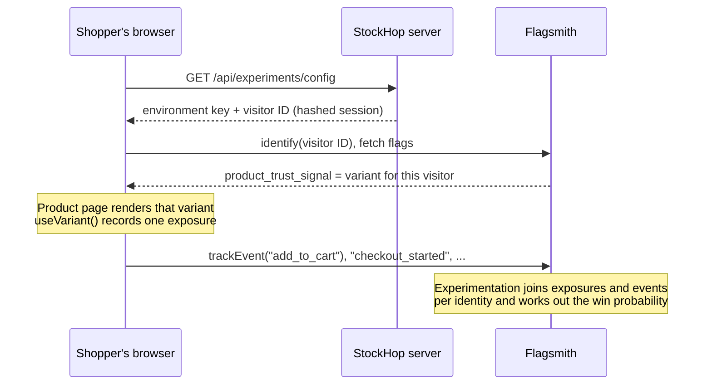

# How StockHop uses Flagsmith

StockHop decides which version of a page a shopper sees with **Flagsmith feature flags**, and measures which version wins with **Flagsmith Experimentation**. This page covers setup, the code, and how to read and act on the results.

The experiment itself (hypothesis, versions, metrics, decision rule) is in [experiment.md](experiment.md).

## How it fits together



1. **The server hands out the identity.** `GET /api/experiments/config` returns Flagsmith's client-side environment key and a visitor ID. The visitor ID is the same one-way hash of the session cookie that StockHop's own clickstream already uses, so Flagsmith's buckets and our analytics describe the same people. It is tied to the browser, not the account, so a shopper keeps their variant if they sign in halfway through a visit.
2. **The browser starts Flagsmith once** with that identity and `enableEvents: true`.
3. **Pages ask for a variant** with `useVariant(flag, variants)`. Calling it records the exposure, so it is called only in the component that shows the difference.
4. **Conversions are sent with `trackConversion(event)`** at the moments listed below.

If no key is set, or Flagsmith can't be reached, every shopper gets the control version and nothing is sent. The store keeps working either way.

## Code map

| File | What it does |
|---|---|
| [`server/routes/experiments.ts`](../server/routes/experiments.ts) | `GET /api/experiments/config`: environment key and visitor ID |
| [`web/src/experiments.tsx`](../web/src/experiments.tsx) | Starts Flagsmith; `ExperimentsProvider`, `useVariant`, `trackConversion`; flag and event names |
| [`web/src/main.tsx`](../web/src/main.tsx) | Wraps the app in `ExperimentsProvider` |
| [`web/src/state.tsx`](../web/src/state.tsx) | `add_to_cart` after a successful add (every add goes through here) |
| [`web/src/pages/Checkout.tsx`](../web/src/pages/Checkout.tsx) | `checkout_started` and `checkout_completed` (with the order total) |
| [`web/src/components/NotifyMe.tsx`](../web/src/components/NotifyMe.tsx) | `back_in_stock_alert` |

The SDK is `@flagsmith/flagsmith` 12.4.0, pinned exactly (the first version with Experimentation support).

## Flags

| Flag | Type | Variants | Where it's read |
|---|---|---|---|
| `product_trust_signal` | Multivariate | control, `reviews`, `local-proof` | Product page (reviews version in progress) |

Code branches on the **variant label**, not the value, so labels must be set on every variation in Flagsmith. A variation created through the API without a label is not counted.

## Conversion events

Event names are case-sensitive and must match the metric in Flagsmith exactly. An event with no matching metric is dropped silently.

| Event | Fired when | `value` | Suggested metric |
|---|---|---|---|
| `add_to_cart` | An item is added to the cart from anywhere (product page, card, "bought together") | none | **Occurrence, higher is better (primary)** |
| `checkout_started` | The shopper presses "Place order" (our cart or a partner shop's item) | none | Occurrence, higher is better |
| `checkout_completed` | The order is confirmed | Order total in rupees | Occurrence (conversion) and Sum (revenue), higher is better |
| `back_in_stock_alert` | A shopper asks to be told when a sold-out item is back | none | Occurrence, informational |

Flagsmith counts a conversion only after that identity's first exposure, so an add to cart before the shopper ever saw the product page doesn't count.

## Setting it up

### 1. Flagsmith account and environment
1. Create an organisation and project on [Flagsmith Cloud](https://app.flagsmith.com). Use one environment for the experiment (for example `Production`).
2. **Environment settings → Warehouse:** enable the managed **Flagsmith** warehouse. Experiments can't be created, and events are rejected, until a warehouse is connected. The first events can take a few hours to appear, so do this early.
3. Copy the environment's **client-side** SDK key.

### 2. Tell StockHop about it
Set this on the web app (Aiven App Runtime variables, or `.env` locally):

```bash
FLAGSMITH_ENVIRONMENT_KEY=<client-side environment key>
```

The key is public by design: it is sent to every browser. It is served at runtime, so changing it needs a restart, not a rebuild. `FLAGSMITH_API_URL` and `FLAGSMITH_EVENTS_URL` are only for self-hosted Flagsmith.

### 3. Create the flag
Create a **multivariate** flag `product_trust_signal`, enabled, with two variations labelled `reviews` and `local-proof`. The control is the flag's default.

### 4. Create the metrics
Create one metric per row of the events table above, with the event name copied exactly.

### 5. Create the experiment
Attach it to `product_trust_signal`, choose how much traffic enters and how it is split (three equal parts), set `add_to_cart` as the primary metric, and write the hypothesis from [experiment.md](experiment.md). Launch it from the Review step.

While an experiment runs the flag is locked. Don't change the rollout mid-test: it can invalidate the result.

## Reading the results and rolling out

On the experiment page, check the **Exposures** panel first: enrolment should match the rollout you chose, split roughly evenly. Then read lift, credible interval and **win probability** for each variant on the primary metric.

When one variant is clearly ahead (see the decision rule in [experiment.md](experiment.md)), end the experiment and roll the winner out to everyone **with the same flag**. No deploy is needed. Afterwards, remove the losing versions from the code and the flag from Flagsmith.

## Checking it works

- `GET /api/experiments/config` should return a non-null `environmentKey` and a 16-character `identity`.
- In the browser's network tab, flags come from Flagsmith after page load, and event batches go out every 10 seconds and when the tab is hidden.
- Flagsmith skips invalid events silently. If nothing arrives, check the event names, that the identity is set, and that the warehouse is connected.
